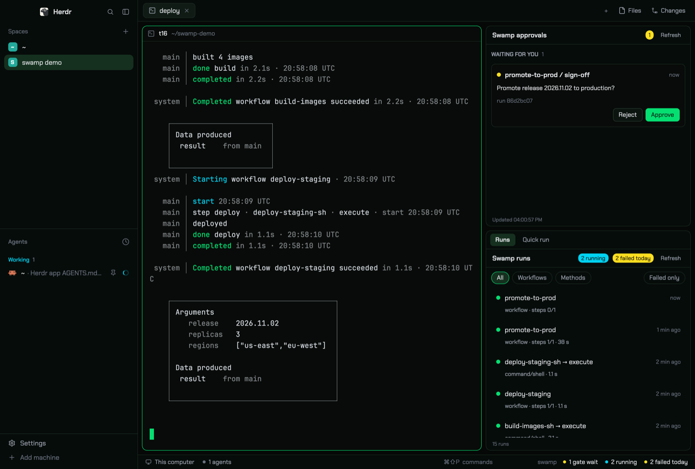

# Herdr swamp layout

A [Herdr](https://herdr.dev) layout with a swamp control column on the right:
workflow gates that wait for approval, recent runs, and a quick-run menu for the
[swamp](https://swamp-club.com) CLI. Every action that changes a run needs a
second click on Confirm.



## Install

**From a swamp repo**, with the published extension
[`@jpisgeek/herdr-swamp-layout`](https://swamp-club.com/extensions/@jpisgeek/herdr-swamp-layout):

```sh
swamp extension pull @jpisgeek/herdr-swamp-layout
swamp behavior create @jpisgeek/herdr-swamp-layout herdr-swamp-layout
swamp behavior run @jpisgeek/herdr-swamp-layout install herdr-swamp-layout
```

**From this repo:** clone it and run `sh install.sh`. See
[INSTALL.md](INSTALL.md).

Both refuse to overwrite existing files.

## Try it safely

[`@jpisgeek/herdr-swamp-fixtures`](https://swamp-club.com/extensions/@jpisgeek/herdr-swamp-fixtures)
adds two harmless workflows, a manual approval gate and a slow failing step, so
you can see every panel state in a scratch swamp repo.

## More

- [RECIPE.md](RECIPE.md): how the layout looks and behaves, and how it is built.
- [jpisgeek/swamp-herdr-extensions](https://github.com/jpisgeek/swamp-herdr-extensions):
  source of both swamp extensions.

The panels watch every open Herdr space whose folder has a `.swamp.yaml`.
