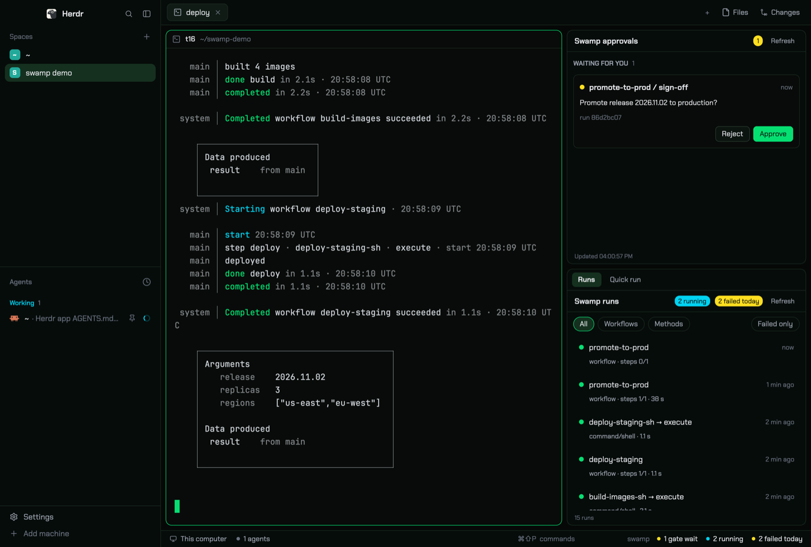

# Swamp

Herdr's main layout with a swamp control column on the right. Gates that wait for a manual approval are always visible at the top. Below them, two tabs show recent workflow and method runs, and a menu that starts a workflow with its inputs filled in. A small item at the right end of the status bar shows the gate and failure counts. Everything that changes a run (approve, reject, resume, cancel, start) needs a second click on a Confirm button. Resume and start run in a visible terminal tab, not hidden in a panel.



## What you see

Left to right, the window is Herdr's `main` layout unchanged (sidebar 268 px with spaces and agents, tab bar 42 px, the active tab's panes as cards, the hidden Files/Changes panel), plus one new column at the right end of the `work-body` row, and a split status bar.

**Swamp column** (400 px wide, min 300, max 700, 8 px gap between its two parts). Both parts are cards: radius 10, 1 px `border`, background `chrome`.

1. **Approvals** (top, weight 1, min 110 px). A header pill counts waiting gates only; runs to resume show only as a section here and as "N to resume" in the status item.
   - Header 36 px: "Swamp approvals" semibold, a red (`blocked`) pill with the count of waiting gates (only when > 0), a muted "Refresh" link (11 px).
   - Body, three sections with an uppercase 11 px muted title and a dim count: **Waiting for you**, **Ready to resume**, **Expired**. Each item is a card (radius 8, `background`, 1 px `border`, padding 10): an 8 px dot (`blocked` for a gate, `done` for ready, `dim` for expired), `workflow / step` semibold 13 px (a ready-to-resume card shows the workflow name only, plus "All gates decided. Steps 1 of 3 done."), age on the right ("5 min ago"), the gate's prompt (12 px), the run's inputs as `key=value` (11 px muted), `run <first 8 chars of id>` (11 px dim), then buttons right-aligned (26 px high, radius 6): **Reject** + **Approve** for a gate, **Resume in new tab** (or **Resume in its tab** when the run's tab is open) for a ready run, **Cancel run** for an expired gate.
   - Empty: "No gates wait for you." centered, muted, with the watched repo paths under it.
   - Footer: "Updated 1:45:28 PM", 10 px dim.
2. **Tools** (bottom, weight 3, min 200 px): a stack with a 36 px tab strip ("Runs", "Quick run"; active tab on `selected`, semibold; tabs 24 px high, radius 6, 12 px text).
   - **Runs**: header "Swamp runs" with pills "N running" (`working`) and "N failed today" (`blocked`; "today" means started in the last 24 h, not the calendar day), Refresh. Filter chips (24 px, radius 12): All, Workflows, Methods, and on the right Failed only. Then the 50 newest runs, newest first. Each row: status dot 8 px (green `ansi2` succeeded, `blocked` failed, `accent` suspended, `dim` cancelled; a braille spinner in `working` for running), title (`workflow name`, or `model → method`), age; second line 11 px muted: kind or model type · `steps 3/6` · duration · repo name if more than one repo. A failed row shows its error in red on a third line. Footer: "48 runs" or "Newest 50 of 120 runs".
   - **Quick run**: header "Swamp quick run", Refresh. One row per workflow: name, a `⏱ <cron>` pill if it has a schedule, the first line of its description (11 px muted, truncated), and "● last succeeded 69 d ago" / "● last failed …" / "never run". Most recently run first.

**Status bar** (28 px): a row with Herdr's `workspace-status` (weight 1) and a 380 px swamp item at the right. The item has the same look as the status bar (`chrome`, top border, 11.8 px): the dim word "swamp", then items with a 6 px dot each: "N gates wait" (red) or "no gates" (grey); "N to resume" (accent, only when > 0); "N running" (working, only when > 0); "N failed today" (red) or "no failures today" (green). Items with a non-zero count use `foreground` text, the others `muted`.

**Look** (from swamp-club.com): theme `swamp-club` in dark mode (`paper` in light mode), interface font Chakra Petch. Near-black green-tinted surfaces (`background` #080b09, `chrome` #060c0a, `canvas` #050806, `border` #1b2a21), light grey text (#e5e7eb, muted #9ca3af), neon green accent and solid buttons (#05df72 on #03130a), cyan for running (`working` #00d3f2), yellow for gates (`blocked` #ffdf20), red #ff6467 and pink #fb64b6 in the terminal colors. The terminal font stays Herdr's default.

## How it behaves

- Agent statuses (working, blocked, done, idle) look exactly as in `main`; this layout does not change how agents show.
- **Polling.** Approvals, Runs and Quick run each read swamp when they start; Approvals and Runs read again every 20 s. Each has a Refresh link. The status item starts no swamp command: it shows what the two panels share, and redraws every 30 s only to notice stale counts. Counts older than 2 minutes show as "gates ?" and "runs ?".
- **Approve / Reject / Cancel run / Resume.** The first click replaces the buttons with a box: a question and one line about the effect, exactly:
  - approve: "Approve this gate?" / "The run then waits for Resume."
  - reject: "Reject this gate?" / "This ends the run. You cannot undo it."
  - resume: "Resume this run?" / "The next steps run in the run's own tab. They can write to real systems."
  - cancel: "Cancel this run?" / "The gate has expired. This ends the run."

  The box has **Confirm** at its left edge and **Back** at its right edge (Confirm solid for approve/resume, red for reject/cancel). The first-step buttons are right-aligned, so Confirm never appears under the pointer: a double-click on Approve does not approve. For approve, reject and cancel, Confirm runs the swamp command in the panel with a spinner, then toasts the result. An error shows in red on the card.
- **Approve does not continue the run.** swamp only records the decision; the run stays suspended and moves to "Ready to resume". **One tab per run.** The first Resume (after Confirm) opens a tab named `resume <workflow> <first 8 chars of run id>` in the repo that runs `swamp workflow resume <workflow> --run <id>`. The shell stays open after swamp ends. A run with more gates comes back to "Ready to resume" after each approve; then the button says **Resume in its tab**, and Confirm shows that tab and types `cd <repo> && swamp workflow resume …` into its shell (`hc send`). While swamp still runs in the tab (its pane's `program.shell` is false), and for 60 s after a Resume click, the card shows "Resuming in its tab" (or "Starting in its tab…") in `working` with a **Show tab** button, and no Resume button. A Resume of a run that still runs only shows its tab, with the toast "Already resuming: <workflow>". The panel reads swamp again 5 s later.
- **New gate.** When a gate appears that no copy has seen, Herdr shows a warning toast ("Swamp gate: <workflow> / <step>", body = the prompt) and plays the `blocked` sound. Clicking the toast opens the approvals window.
- **New failure.** When a run fails after a Runs copy has loaded once, an error toast shows ("Swamp run failed: <title>", body = error). Clicking it opens the runs window (`mod.open swamp-runs`). Old failures never toast, not even after a restart.
- **Runs rows.** Click a row to expand it: status word, failed step, error (for a failed method run the error is fetched on first expand, with a spinner), inputs, full run id and repo, and buttons **Logs** and **Latest report**. They run `swamp workflow|behavior history logs <id>` or `swamp report get @swamp/workflow-summary --workflow <name>` / `@swamp/method-summary --behavior <model>` in one shared tab, `swamp logs`: the first click opens it; later clicks show it and type `clear && cd <repo> && <command>` into its shell. If a program still runs there (a pager), nothing is typed: the tab shows, with the toast "The swamp logs tab is busy". Click again to fold.
- **Quick run.** Click a workflow: the panel shows "‹ Workflows" (back), the name, repo, full description, last result, then one field per input with its name, a red `*` if required, its type ("list of string"), and its description. Fields are filled from the last run's inputs ("Filled from the last run", link **Use defaults**), or from the schema defaults ("Filled from the defaults", link **Use last run**). Lists are typed as `a, b` or as a JSON list. The footer has **Run in new tab**, or **Run in its tab** when the workflow's tab is open. The fields are checked only when it is clicked (type, required, minItems, enum). A wrong field turns its border red with "hostnames needs at least 1 item" under it, and the footer says "Correct the inputs marked in red." Otherwise the footer shows a red-bordered box "This runs in a new tab in ~/repo:" with the exact command, and the buttons **Confirm run** (red) at the left edge and **Cancel** at the right edge, where **Run in new tab** was. Each workflow has one tab, `run <workflow>`: Confirm opens it with `swamp workflow run <name> --input '<json>'`, or types `cd <repo> && <command>` into it when it is open. While swamp still runs in it, the footer shows "<name> still runs in its tab. Start it again when it ends." in `working`, with **Show tab**, and no Run button. After a start it shows "Started <name> in its tab." in green, and the list reads swamp again 4 s later. Editing any field after the first click cancels the confirm.
- **Status item clicks.** Gates / to resume: nothing in this layout (approvals is always visible); in a layout without it, opens the approvals window. Running / failed: selects the Runs tab (`layout.select {stack: "swamp-tools", child: "swamp-runs"}`); in a layout without that stack, opens the runs window.
- All four panels also open as floating windows from the palette (`mod.open swamp-approvals`, `swamp-runs`, `swamp-quickrun`), with a × to close. There is no key binding.
- Nothing moves on its own except spinners (native `.frames`).

## Built from

**Layout** `layouts/swamp.json`: `layout.clone {"name": "main", "as": "swamp"}` (this also switches the window to the clone; it writes `cloned_from: {name, version}` itself), then four edits.

- In the `work-body` row, after `panel`, add:
  ```
  column "swamp" {px 400, min 300, max 700, gap 8}
    block "swamp-approvals" {weight 1, min 110, radius 10, border 1 border, background chrome}  mod swamp-approvals
    stack "swamp-tools" {weight 3, min 200, same card look, active "swamp-runs",
                         header {content: {mod: "swamp-tabs", props: {stack: "swamp-tools"}}, height: 36}}
      block "swamp-runs"     mod swamp-runs
      block "swamp-quickrun" mod swamp-quickrun
  ```
- Replace the `status` block with row `status-row` {px 28, resizable false}: the old `status` block with `size {weight 1}`, then block `swamp-status` {px 380} with mod `swamp-status`.
- Root `"preview": "layouts/swamp.svg"`.
- Root `"theme": {"light": "paper", "dark": "swamp-club"}` and `"ui_font": "Chakra Petch"`.

**Theme** `themes/swamp-club.json`: `background` #080b09, `foreground` #d1d5db, `selection` #0f3a24, `cursor` #05df72; `ansi` #1b2a21 #ff6467 #05df72 #ffdf20 #51a2ff #fb64b6 #00d3f2 #d1d5db / bright #4b5563 #ff8a8c #5ee9a0 #fff085 #8ec5ff #fda5d5 #53eafd #ffffff; `colors`: canvas #050806, chrome #060c0a, surface/popover #0c1410, raised #101b15, hover #13221a, selected #15301f, border #1b2a21, input #2a3d31, foreground #e5e7eb, muted #9ca3af, dim #6b7280, accent/solid #05df72, accent_foreground/solid_foreground #03130a, working #00d3f2, blocked #ffdf20, done #05df72.

**Fonts** `mods/swamp-tabs/fonts/`: ChakraPetch-Regular/Medium/SemiBold/Bold.ttf and OFL.txt, from `github.com/google/fonts/raw/main/ofl/chakrapetch/` (SIL Open Font License). They sit in a mod folder so they travel with the layout.

**Mods** (all `mod.json` `"place": "none"`; the three panels also have `"overlay": {"kind": "window", width, height, "key": <mod name>}`: approvals 380×600, runs 440×640, quick run 460×620).

- `swamp-approvals`, `swamp-runs`, `swamp-quickrun`: each has `const REPOS = []`, adds `props().repos`, and adds the folder of every local space (`!space.machine`) that has a `.swamp.yaml` (`readTextFile`).
- `swamp-tabs`: the stack's tab strip. Its tabs are fixed in the code: `swamp-runs` → "Runs", `swamp-quickrun` → "Quick run" (props may override with `tabs: [{id, label}]`). Reads `layout()` (the tree), finds the stack by id, highlights its `active` child, `run("layout.select", {stack, child})` on click.
- `swamp-status`: reads `shared("swamp-approvals.summary")` = `{gates, ready, at}` and `shared("swamp-runs.summary")` = `{running, failedToday, at}`.

**Shared keys** (all `at` values are epoch milliseconds): `swamp-approvals.seen` (gate keys `runId/step` already toasted; only open ones kept), `swamp-approvals.count` (number of waiting gates), `swamp-approvals.summary`, `swamp-runs.failed-seen` (run keys already toasted, last 500), `swamp-runs.summary`.

**herdr functions**: `exec`, `run`, `notify` (with `action: {name: "mod.open", args: {name}}`), `playSound("blocked")`, `shared` / `setShared`, `spaces`, `readTextFile`, `home`, `props`, `closeOverlay`, `layout`, `theme`. Commands: `tab.new {name, folder, argv}`, `layout.select`, `mod.open`.

**Programs**: the `swamp` CLI (tried as `swamp`, else `~/.local/bin/swamp`). Commands the panel reads with `exec` get `--json` and `cwd` = the repo; commands opened in a tab for people to read (resume, run, logs, report) get no `--json`:

| Use | Command |
|---|---|
| gates | `swamp workflow approvals` → `{approvals[], expired[]}` (workflowId, workflowName, runId, stepName, prompt, inputs, suspendedAt, initiatedBy); the mods read `expired[]` items with the same fields and fall back to `?` |
| ready to resume | `swamp workflow history search --filter 'status == "suspended"'`, minus runs that still have a gate |
| approve / reject | `swamp workflow approve <wf> <step> --run <id> --reason "Approved in Herdr"` (reject: `reject`, "Rejected in Herdr"); approve returns `allGatesDecided` |
| cancel | `swamp workflow cancel <wf> --run <id>` |
| workflow runs | `swamp workflow history search` → `results[]` (runId, workflowName, status, startedAt, duration in ms, stepProgress `{completed, total}`, failedStep, failureReason, inputs, triggerSource) |
| method runs | `swamp behavior history search` → `results[]` (id, modelName, type, methodName, status, startedAt, durationMs) |
| method error | `swamp behavior history get <id>` → `error.message` |
| running now | `swamp run history --active` → `runs[]` (id, runKind `workflow`/`model_method`, workflowName, modelType, methodName, status, startedAt, stale) |
| workflows | `swamp workflow search` → `results[]` (name, description, hasInputs, trigger.schedule) |
| inputs | `swamp workflow get <name>` → `inputs` (JSON schema: properties, required, default, items, minItems) |
| start | `swamp workflow run <name> --input '<one JSON object>'` (in a tab) |

**Art**: `layouts/swamp.svg`, 320×200: the main layout in dark greys with a narrow right column of two cards (a small one with a red button, a tall one with green and red dots).

## Watch out

- Never put a Confirm button where the first-step button was. In a first build, Confirm replaced Approve at the same spot, and two clicks to bring the window forward approved gates without anyone meaning to.

- Do not pick `swamp-club` with `app.theme` or the theme menu. Herdr 0.1.12 files it as a light theme, saves `{"light": "swamp-club", "dark": <old>}` in `layouts/.state/swamp.json`, and dark mode keeps the old theme. Set the `{light, dark}` theme in the layout file. If a pick is already saved, remove `theme` from the state file.
- `herdr-app shot` saves the last frame drawn. When another app covers Herdr, the frame can be minutes old. Bring Herdr to the front and wait a few seconds before the shot.

- AGENTS.md says a stack can use `"header": "tabs"` for a plain strip. Herdr 0.1.12 rejects it ("invalid type: string \"tabs\", expected struct Header"). A stack header takes the same `{content: {mod, props}, height}` shape as a pane-frame header; use a header mod (`swamp-tabs`).
- `InputState.new` works only in `init` or an event handler, never in `render` or after an `await` in `render`. Quick run creates its fields inside the click that picks a workflow, or in the task that the click starts.
- `mod.json` `overlay.kind: "window"` and `overlay.key` are honoured by this version (the window opens floating, and `mod.open` again closes it), though AGENTS.md documents only width and height there.
- `REPOS` entries start with `~/`; expand them with `home()` before `exec`.
- A mod opened with `mod.open` and `"place": "right"` did not dock; it opened as a 0-height window. Give each panel `"place": "none"` and a window overlay with fixed width and height.
- In a window, a press drags the window. Every button needs `.on_mouse_down("left", (_e, cx) => cx.stop_propagation())`.
- `swamp workflow approve` does not continue the run. Without the "Ready to resume" section, an approved run waits forever with no visible sign.
- `swamp` history says `succeeded`, the run tracker says `completed`: treat them as the same.
- Most runs in a typical repo are method runs, not workflow runs. A runs list with workflows only looks empty.
- Method history has no error text; fetch it on expand with `behavior history get`.
- Some method runs have no log file; the Logs tab then says "Log file not found".
- `swamp report get` has no option to select a run: "Latest report" shows the most recent run of that workflow or behavior, which can be a different run from the row.
- Pass all workflow inputs as one JSON object to `--input`. `key=value` breaks on lists and on values with commas or `=`.
- `tab.new` with `argv` runs in the interactive shell, which stays open after swamp exits. Do not wrap the command in `sh -c "...; read"`.
- Every tab the panels open stays open after swamp ends (the shell stays). Name each tab after its job (`resume <workflow> <id8>`, `run <workflow>`, `swamp logs`), find it by name in `spaces()`, and type the next command into its shell with `hc send`. A tab is busy when its pane's `program.shell` is false.
- A workflow with several gates needs one resume per gate. A new tab per resume leaves one stale tab per gate, and the run can still read "suspended" while a resume starts, so a second click starts a second resume. Use one tab per run, and hide Resume while swamp runs in it.
- `exec` stops after 30 s. Long commands (resume, run) must go to a tab, never `exec`.
- Two copies of one panel (docked + window) each toast unless the "already toasted" list is shared. Seed that list on the first load so a restart does not toast old failures. Two copies that refresh at the same moment can still both toast; this is rare and accepted.
- The status item shows nothing current without the panels: it depends on their shared summaries. In a layout without them it shows "?".
- Show the exact command next to the Confirm button (in the footer), not at the end of a long form, where it scrolls out of sight.
- The layout is a clone: it does not get Herdr's later changes to `main`.
- `REPOS` is empty by default and a constant per panel. Open a space in each swamp repo, or add its path to `REPOS`.
- Any of these can run commands on real systems. The panels do not know which workflows are dangerous; the confirm step is the only guard.

## Done when

- `herdr-app check` passes for `swamp-approvals`, `swamp-runs`, `swamp-quickrun`, `swamp-tabs` and `swamp-status`, and `herdr-app status` shows no errors with `layout.switch {"name": "swamp"}`.
- The right column shows approvals at the top and Runs at the bottom; `layout.select {"stack": "swamp-tools", "child": "swamp-quickrun"}` shows the workflow list and the "Quick run" tab highlights.
- Do the next checks in a **scratch swamp repo** (`swamp init` in an empty folder, then open a Herdr space there so the panels watch it), never in a repo that reaches real systems. Add these two workflows to its `workflows/` folder, and a `command/shell` behavior named `herdr-test` (method `execute`, argument `run: echo ok`):

  ```yaml
  # workflows/workflow-gate-test.yaml
  id: <new uuid>
  name: gate-test
  description: Test gate. Does nothing.
  tags: {}
  jobs:
    - name: main
      steps:
        - name: check-it
          task: { type: manual_approval, prompt: "Test gate", timeout: 86400 }
          dependsOn: []
          weight: 0
          allowFailure: false
  ```

  ```yaml
  # workflows/workflow-fail-test.yaml
  id: <new uuid>
  name: fail-test
  description: Runs for some seconds, then fails. Changes nothing.
  tags: {}
  inputs:
    properties:
      seconds: { type: integer, default: 30 }
  jobs:
    - name: main
      steps:
        - name: slow-fail
          task:
            type: model_method
            modelIdOrName: herdr-test
            methodName: execute
            inputs: { run: "echo start; sleep ${{ inputs.seconds }}; exit 3" }
          dependsOn: []
          weight: 0
          allowFailure: false
  ```
- `swamp workflow run gate-test` in the scratch repo shows under "Waiting for you" within 20 s with a toast and the blocked sound; the status item says "1 gate waits".
- Approve → Confirm moves it to "Ready to resume"; Resume in new tab → Confirm opens a tab `resume <workflow> <id8>` that finishes the run; a later refresh shows the run as succeeded in Runs. With a workflow of two gates: after the second approve the button says "Resume in its tab", Confirm types the command into the same tab, and no second tab opens. Clicking Resume twice fast opens one tab only. Two Logs clicks on different runs use the one `swamp logs` tab. Starting the same workflow twice from Quick run uses the one `run <workflow>` tab; while the first run still runs, there is no Run button.
- Reject → Confirm ends the run; it shows as failed in Runs, and only one toast appears even with the runs window open too.
- In Quick run, a required list input left empty shows a red border and blocks the run; filled, the footer shows `swamp workflow run <name> --input '{…}'` and Confirm run opens a tab with exactly that command.
- Quick run → fail-test → Confirm run: the Runs panel shows the run with a spinner and "1 running" for about 30 s, then a red row "slow-fail: Command exited with code 3", one error toast, and "failed today" goes up by one in the header pill and in the status item.
- After the first refresh, `shared.json` holds `swamp-approvals.summary` and `swamp-runs.summary` with an `at` time from the last 20 s. The status item's gate count matches the approvals pill, and its running and failed counts match the Runs pills.
